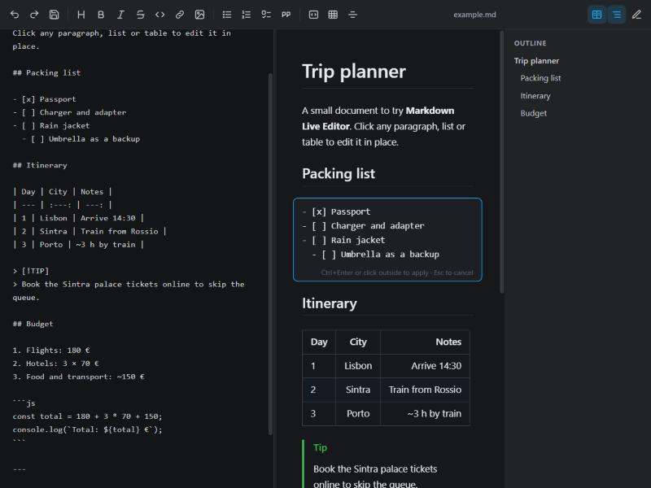

# Markdown Live Editor

[← All extensions](../README.md)

A Visual Studio Code extension that shows Markdown as a rendered page and lets you edit it in place. Click a paragraph, list, table or code block and its Markdown opens right there; click outside and the page updates. The file stays plain Markdown.

  



## Features

- GitHub-style rendering: headings, emphasis, links, images, nested and ordered lists, task lists, tables with alignment, fenced code, block quotes, alerts (`> [!NOTE]`), front matter and common inline HTML (`<kbd>`, ``, `<details>`, …).
- Click-to-edit blocks, with `+` buttons between blocks to add new ones.
- Task list checkboxes toggle directly in the rendered page.
- Formatting toolbar and shortcuts that work on the block you are editing or on the source pane.
- Lists continue automatically on `Enter`; `Tab` / `Shift+Tab` indent and outdent.
- Optional side-by-side source pane and an outline of headings.
- Relative links to other `.md` files open in the same editor; images with relative paths are shown.
- Works on the document as text: Save, Undo/Redo and Git behave like any other file.

## Requirements

- Visual Studio Code 1.86 or newer.

## Installation

### From source

```bash
git clone https://github.com/mart1-cast3ll/vscode-extensions.git
cd vscode-extensions/markdown-live-editor
code .
```

Press `F5` and choose **VS Code Extension Development** if asked. A new window opens with the extension loaded; open `samples/example.md` there.

### From a `.vsix` file

Download `markdown-live-editor-0.1.0.vsix` from the [latest release](https://github.com/mart1-cast3ll/vscode-extensions/releases/tag/markdown-live-editor-v0.1.0), then in VS Code open **Extensions** → `⋯` → **Install from VSIX…**, or run:

```bash
code --install-extension markdown-live-editor-0.1.0.vsix
```

## Usage

Open a Markdown file in the editor:

| Where | How |
| --- | --- |
| Explorer | Right-click a `.md` file → **Open in Markdown Live Editor** |
| Editor title bar | With a Markdown file (or the built-in preview) open, click the book icon. If the bar is narrow it may be under `⋯` |
| Tab or editor | Right-click the tab or inside the text → **Open in Markdown Live Editor** |
| Keyboard | `Ctrl+Shift+Alt+V` (`Cmd+Shift+Alt+V` on macOS) |
| Command Palette | **Markdown: Open in Markdown Live Editor** |
| Any file | **Open With…** → **Markdown Live Editor** (can be set as default for `*.md`) |

### Example: tick a task and add a row to a table

1. Open `samples/example.md`.
2. Click the **Charger and adapter** checkbox. The line becomes `- [x] Charger and adapter`.
3. Click the itinerary table. Its Markdown opens in place; add a line:

   ```markdown
   | 4 | Lisbon | Flight home 18:00 |
   ```

4. Press `Ctrl+Enter` or click outside the block. The table re-renders with the new row.
5. Press `Ctrl+S`.

### Example: start a new section

1. Hover between two blocks and click the `+` that appears.
2. Click the **Heading** button and type `Restaurants`, then press `Ctrl+Enter`.
3. Click `+` below it, press the **Bulleted list** button and type the first item. `Enter` starts the next item; `Enter` on an empty item ends the list.

### Toolbar

| Button | Inserts |
| --- | --- |
| Heading | `#`, `##`, `###`, none (cycles) |
| Bold / Italic / Strikethrough / Code | `**text**`, `*text*`, `~~text~~`, `` `text` `` |
| Link / Image | `[text](https://)`, `` |
| Bulleted / Numbered / Task list, Quote | `- `, `1. `, `- [ ] `, `> ` on each selected line |
| Code block / Table / Divider | a fenced block, a 2×2 table, `---` |

With no block open, block buttons (heading, lists, quote, code block, table, divider, image, link) add a new block at the end of the document.

### Keyboard shortcuts (while editing)

| Shortcut | Action |
| --- | --- |
| `Ctrl+B` / `Ctrl+I` / `Ctrl+E` | Bold / italic / inline code |
| `Ctrl+K` | Link |
| `Ctrl+Shift+X` | Strikethrough |
| `Enter` | Continue the current list |
| `Tab` / `Shift+Tab` | Indent / outdent |
| `Ctrl+Enter` | Apply the block |
| `Esc` | Discard changes to the block |
| `Ctrl+Z` / `Ctrl+S` | Undo / save (VS Code) |

## How it works

- The document is split into top-level blocks, each mapped to its line range. Applying a block replaces exactly those lines; the rest of the file is untouched.
- Raw HTML is passed through a whitelist (formatting, images, tables, `<details>`); scripts, styles, iframes and event handlers are removed.
- External links open in the browser. Relative links open the target file in VS Code.

## Known limitations

- Reference-style links (`[text][id]`) and footnotes are shown as plain text.
- Code blocks are not syntax highlighted.
- Clicking a block places the cursor at the end of its Markdown, not at the clicked word.

## Building the package

```bash
# Windows, no Node.js required
powershell -ExecutionPolicy Bypass -File scripts/package.ps1

# Any platform, with Node.js
npx @vscode/vsce package --out dist/
```

## Project structure

```
src/
  extension.js     activation, custom editor provider, command
  session.js       document ↔ webview sync and message handlers
  html.js, log.js, constants.js
media/
  editor.html
  css/             base, toolbar, layout, markdown, editing
  js/
    main.js        entry point and host messages
    document.js    text model: replace lines, insert blocks, toggle tasks
    preview.js     rendered page and click handling
    block-editor.js  in-place block editing
    format.js      toolbar and shortcut commands on a textarea
    source-pane.js, outline.js, toolbar.js, keyboard.js
    md/            Markdown parser: blocks.js, inline.js, render.js, sanitize.js
docs/images/       README screenshot
samples/
  example.md
scripts/
  package.ps1      builds the .vsix without Node.js
```

## Changelog

See [CHANGELOG.md](CHANGELOG.md).

## License

[MIT](LICENSE)
