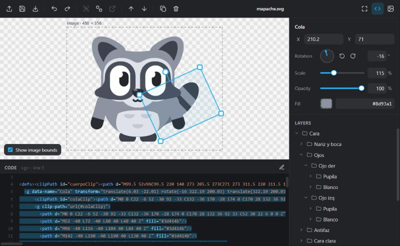

# SVG Layers Editor

[← All extensions](../README.md)

A Visual Studio Code extension that opens any `.svg` file as an editable drawing. Every group and shape becomes a layer you can select, move, rotate, scale, recolor, regroup and reorder, while the file stays plain SVG text.

  



| Before | After |
| :---: | :---: |
|  |  |
| `samples/mapache.svg` as shipped | Pupils moved, tail raised and scaled, saved from the editor |

## Features

- Layers panel built from the SVG structure (`<g>`, `<a>`, `path`, `rect`, `circle`, `ellipse`, `line`, `polyline`, `polygon`, `text`, `use`, `image`).
- Move, rotate and scale on the canvas or from the properties panel.
- Group, ungroup and move layers in and out of groups without visual changes.
- Drag and drop layers to reorder them or change their group.
- Fill color picker and opacity.
- Code panel synced with the selection: select a shape to jump to its markup, click the markup to select the shape.
- The saved image grows automatically to fit every visible object.
- PNG export.
- Works on the document as text: Save, Undo/Redo, Git diff and "unsaved" state behave like any other file.

## Requirements

- Visual Studio Code 1.86 or newer.

## Installation

### From a `.vsix` file

Download `svg-layers-editor-0.2.0.vsix` from the [latest release](https://github.com/mart1-cast3ll/vscode-extensions/releases/tag/svg-layers-editor-v0.2.0) (all versions: [Releases](https://github.com/mart1-cast3ll/vscode-extensions/releases)), then either:

- In VS Code: **Extensions** view → `⋯` menu → **Install from VSIX…** → pick the file, or
- From a terminal:

  ```bash
  code --install-extension svg-layers-editor-0.2.0.vsix
  ```

To update, install the newer `.vsix` over it. To remove it:

```bash
code --uninstall-extension mart1-cast3ll.svg-layers-editor
```

### From source (development)

```bash
git clone https://github.com/mart1-cast3ll/vscode-extensions.git
cd vscode-extensions/svg-layers-editor
code .
```

Press `F5`. A new VS Code window opens with the extension loaded and the `samples/` folder.

## Building the package

The extension has no dependencies and no build step. To produce `dist/svg-layers-editor-<version>.vsix`:

```bash
# Windows, no Node.js required
powershell -ExecutionPolicy Bypass -File scripts/package.ps1

# Any platform, with Node.js
npx @vscode/vsce package --out dist/
```

Bump `version` in `package.json` and add an entry to `CHANGELOG.md` before building a new release.

## Sharing without the Marketplace

1. Build the `.vsix` as above.
2. Create a release on GitHub (**Releases** → **Draft a new release**), tag it `svg-layers-editor-v<version>` (for example `svg-layers-editor-v0.2.0`) and attach the `.vsix` file.
3. Users download it and follow [From a `.vsix` file](#from-a-vsix-file).

## Usage

Open an SVG in the editor in any of these ways:

| Where | How |
| --- | --- |
| Explorer | Right-click a `.svg` → **Open in SVG Layers Editor** |
| Editor title bar | With a `.svg` open, click the layers icon |
| Command Palette | **SVG: Open an SVG in SVG Layers Editor…** |
| Inside the editor | **Open SVG** button, or hold `Shift` and drop a file onto the editor |
| Any file | **Open With…** → **SVG Layers Editor** (can be set as default for `*.svg`) |

### Walkthrough: make the raccoon look to the side

This produces the **After** image above from `samples/mapache.svg`.

1. Right-click `samples/mapache.svg` → **Open in SVG Layers Editor**.
2. In **Layers**, expand `Cara › Ojos › Ojo izq` and select `Pupila`. Add `7` to **X** and subtract `4` from **Y** (or drag it with the mouse). Repeat for `Ojo der › Pupila`.
3. Click the tail on the canvas to select `Cola`. Set **Rotation** to `-16` and **Scale** to `115`, then drag it up a little. The code panel highlights the `<g data-name="Cola">` element while you work.
4. Press `Ctrl+S`.

Only the `transform` attributes of the edited groups change in the file:

```diff
- <g data-name="Cola" transform="translate(-35.28 10.28) rotate(-8.54 …) …">
+ <g data-name="Cola" transform="translate(6.03 -22.01) rotate(-16 322.19 200.03) translate(322.19 200.03) scale(1.15) translate(-322.19 -200.03) translate(-35.28 10.28) rotate(-8.54 …) …">

- <g data-name="Pupila">
+ <g data-name="Pupila" transform="translate(7 -4)">
```

### Example: move a part out of its group

1. Open `samples/mapache.svg`.
2. Double-click the eyes. The context switches to the `Cara` group and `Ojos` is selected.
3. Click **Move out of group** (`Ctrl+Shift+L`). `Ojos` is now a top-level layer and stays exactly where it was.
4. Drag it outside the drawing. The dashed frame labelled `Image · W × H` grows to include it.
5. Press `Ctrl+S`. The saved `viewBox` (and `width`/`height`, if present) now covers the whole drawing.

### Example: recolor a group

1. Select `Orejas` in the layers panel.
2. Click the fill swatch and pick a color on the wheel, or type `#c47a3a`.
3. Every filled shape inside the group gets `style="fill: …"`, so it overrides CSS classes too.

### Canvas

| Action | Result |
| --- | --- |
| Click | Select the top-level layer under the cursor (or the next level inside the current group) |
| Double-click | Enter the selected group |
| `Shift` + click | Add or remove from the selection |
| Drag a shape | Move |
| Drag a corner handle | Scale |
| Drag the round handle | Rotate (`Shift` snaps to 15°) |
| Mouse wheel | Zoom |
| Drag the background / middle button | Pan |
| **Show image bounds** checkbox | Toggle the dashed frame of the exported area |

### Keyboard shortcuts

| Shortcut | Action |
| --- | --- |
| `Ctrl+G` | Group |
| `Ctrl+Shift+G` | Ungroup |
| `Ctrl+Shift+L` | Move out of group |
| `Ctrl+D` | Duplicate |
| `Ctrl+A` | Select all in the current group |
| `Del` / `Backspace` | Delete |
| `]` / `[` | Bring forward / send backward |
| Arrow keys (`Shift` ×10) | Nudge |
| `F2` | Rename |
| `Enter` | Enter the selected group |
| `Esc` | Leave the current group / clear selection |
| `Ctrl+Z` / `Ctrl+Y` / `Ctrl+S` | Undo / redo / save (handled by VS Code) |

## How it works

- **Layers.** A layer is any group or shape whose parent is the root `<svg>` or another group. Content inside `<defs>`, `<clipPath>`, `<mask>`, `<pattern>`, `<symbol>`, `<marker>` and gradients is preserved but not listed.
- **Names.** Taken from `data-name`, then `inkscape:label`, `aria-label`, a `<title>` child, and finally the tag name plus `#id`. Renaming writes `data-name`.
- **Transforms.** Edits are added in front of the element's existing `transform`, which is never rewritten.
- **Regrouping.** When a layer changes group, its transform, inherited paint (`fill`, `stroke`, fonts, …) and opacity are compensated so it does not move or change color.
- **Saving.** After every change the full SVG is written back to the document. Formatting of the root tag and empty elements is normalized by the XML serializer.
- **Invalid files.** A syntax error shows the line and column, highlights it in the code panel and locks the canvas until the source is fixed. Empty files and a missing `xmlns` offer a one-click fix.
- **Diagnostics.** Unexpected errors are logged to **Output › SVG Layers Editor**.

## Known limitations

- `<style>` blocks inside the SVG apply to the whole editor view.
- Moving a layer out of a group that has `clip-path`, `mask` or `filter` removes that effect from the layer (a notice is shown).
- Dropping files from the OS onto the editor requires holding `Shift` (VS Code behavior).

## Project structure

```
src/
  extension.js     activation, custom editor provider, commands
  session.js       document ↔ webview sync and message handlers
  files.js         open dialog, dropped files
  html.js          webview HTML template
  log.js           output channel
  constants.js
media/
  editor.html
  css/             base, toolbar, canvas, code, sidebar, color-picker
  js/
    main.js        entry point and host messages
    document.js    parse, load, serialize, commit
    layers.js      layer model and naming
    transform.js   per-element move/rotate/scale
    hierarchy.js   group, ungroup, move between groups
    edit.js        reorder, duplicate, delete, nudge
    bounds.js      exported image area
    pointer.js     canvas mouse interaction
    overlay.js     selection handles and image frame
    props.js       properties panel
    color*.js      color helpers and picker
    layers-panel.js, code-panel.js, xml-scan.js, toolbar.js, keyboard.js, file-drop.js, png.js, view.js
samples/
  mapache.svg
docs/images/       README screenshots and before/after SVGs
scripts/
  package.ps1      builds the .vsix without Node.js
```

## Changelog

See [CHANGELOG.md](CHANGELOG.md).

## License

[MIT](LICENSE)
